<p align="center">
  <picture>
    <source media="(prefers-color-scheme: dark)" srcset="assets/banner-dark.svg">
    
  </picture>
</p>

<p align="center">
  <a href="https://github.com/facebookresearch/sam3"></a>
  
  <a href="https://github.com/nerfstudio-project/gsplat"></a>
  <a href="https://github.com/colmap/colmap"></a>
  <a href="https://github.com/facebookresearch/dinov2"></a>
  
  <a href="LICENSE"></a>
</p>

<p align="center">
  <picture>
    <source media="(prefers-color-scheme: dark)" srcset="assets/hero_strip-dark.jpg">
    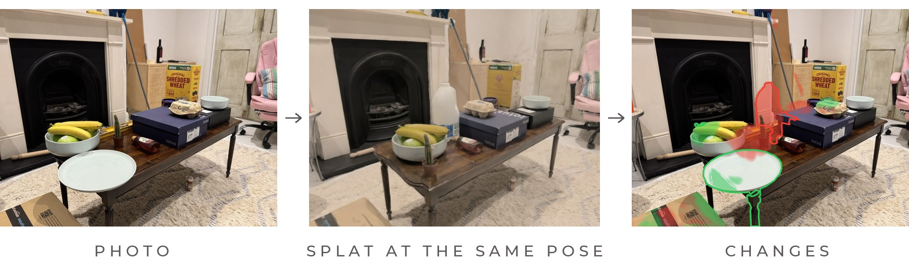
  </picture>
</p>

<p align="center"><b>A pipeline that films a room once and tells me, from a few photos taken later, what was put down or taken away and what was moved, with a confidence for each line and a film that flies to every change.</b></p>

<p align="center">My submission for the <b>Humanoid Spatial AI internship challenge</b> ("What changed in the room?"), October 2026.</p>

<p align="center"><b>Live write-up:</b> I keep updating this repo after the challenge deadline. If you are reading a cloned copy, the latest version is at <a href="https://ar3o.github.io/where-did-my-stuff-go/">ar3o.github.io/where-did-my-stuff-go</a>.</p>

## Why I built this

My idea for this project was to copy a situation that a home robot or any physical AI system will be in all the time. Over the first days in your house it gets familiar with the place, so it knows where the mugs live, which box is the shoe box and where the broom leans, and here that memory is a Gaussian splat built from one walk through the room. After that the room keeps changing without the robot being told, because someone borrows the screwdriver, leaves a parcel on the table or puts the fruit bowl somewhere else, and a robot that acts on a stale memory reaches for things that are not there anymore. So the question I wanted to answer is how much a robot can notice the moment it walks into a room, or from wherever it happens to be standing, without having to walk around to collect more views first, and the small sets of photos are exactly that: a few glances from the spot where the robot is.

I picked a splat for the memory because it can render what the room should look like from any pose the robot ends up at, which turns "what changed?" into a comparison between what the robot remembers and what it sees from the same viewpoint, and because its Gaussians can be grouped into objects afterwards, so the answer can be one line per object with a number saying how much to trust it instead of a heatmap. I also wanted the checker to be trained on the room it lives in, the same way the robot learns one house, so I train a small model on edits of the splat itself instead of writing rules per object type or asking a vision-language model to compare two pictures, which in my early tests mistook a change of viewpoint for a change of the room.

I made the data deliberately tricky, because real homes are messy and an easy test would not say much. The room is my cluttered living room with about 40 objects on and around a coffee table, and a lot of those are plain cardboard boxes that look alike, which is the kind of thing a robot has to tell apart by where it was and not only by how it looks. For the changes I wanted to test object permanence and the difference between identity and appearance, so some objects moved but stayed in the frame, in one set I put a second identical object right next to the original, another set has a plate that was added, in some I hid things behind other things, and a few objects went back where they were after I had moved them. I took the photos from wherever I was standing, including the sofa side of the room that the walk never covered closely, because a robot will not always come in from the places it learned the room from, so it also has to know when it cannot see well enough and say it cannot verify something instead of guessing. Between the sets I reset the room to its original state, so every set is compared with the reference walk only and never with the set before it. The current data is one three-minute walk, 22 change sets with 3 photos each, and 5 photos of the untouched room, and the only thing I tell the system about the room is a list of object names that I wrote after looking at the photos.

The scope is one static room that has been filmed once, with objects from a few centimetres up to furniture size and changes that leave a visible trace in at least one photo. People walking around, places nobody filmed well and objects that are missing from the name list are outside it. I built this for the Humanoid Spatial AI internship challenge ("what changed in the room?") and I am carrying on with it after the deadline, and the next step is letting the robot decide where to look next when the first glance is not enough.

<p align="center">
  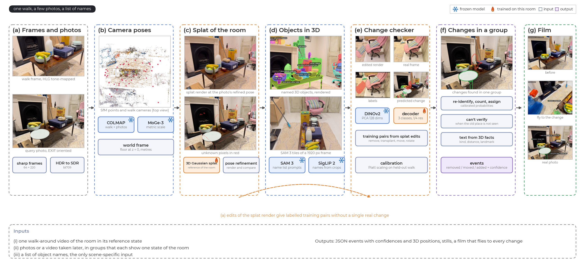
  <br><sub>The full pipeline. The only scene-specific input is a list of object names.</sub>
</p>

## 1. Filming the room and taking the photos

I walked around the living room with an iPhone for about three minutes at roughly one height, and then I changed things one set at a time and took three photos after each set from wherever I was standing, with the 5 photos of the untouched room taken first. The iPhone records in HDR (HLG), and when I decoded the video the obvious way it came out flat and grey next to the SDR photos, which anything comparing the two would read as a colour change across the whole image, so I tone-map the video to SDR bt709 while decoding it, with a linearise at 100 nits followed by a Hable curve.

<p align="center">
  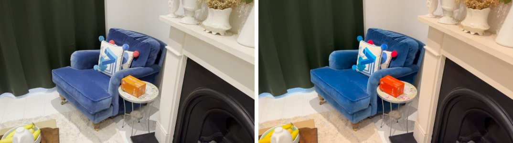
  <br><sub>One reference frame decoded with plain scaling (left) and with the tone-mapping chain (right).</sub>
</p>

From the video I keep the sharpest frame of each of 64 equal time slices, which I call keyframes, and 220 further frames that are at least 0.15 s from any keyframe, so a blurry frame or one with my hand over the lens never reaches the reconstruction, and that gives 276 frames. Every eighth of the extra frames is held out to measure the splat on views it never saw, and the last 20 % of the walk by time stays out of every calibration later on. The photos are HEIC files, so they get their EXIF rotation applied and are stored at 960 px wide for the comparison and 1920 px for the object detector.

## 2. Camera poses

I run pycolmap on the frames and the photos together, since it is accurate and since the photos then end up in the same coordinates as the walk without any extra alignment step. Matching every pair would take too long, so each frame is matched with its next twelve neighbours and with its six nearest keyframes, and the keyframes are matched with each other so that the loop around the room closes. A photo is matched with all the keyframes first and then with the frames around the keyframes it matched best, which keeps the whole thing at a few minutes on the CPU. 271 of the 276 frames register at 0.62 px reprojection error and 70 of the 71 photos register at 0.82 px.

My first attempt used Pi3X, a feed-forward reconstruction model that is fast and gives metric scale directly. On an earlier test table I trained the same splat on Pi3X poses and on SfM poses, and the held-out frames came out at 19.6 dB with Pi3X and 27.6 dB with SfM, so the poses come from SfM. SfM has no scale of its own and the published runs still took theirs from Pi3X, while this repository takes it from MoGe-3 metric depth at the triangulated keypoints, which makes the room about 11 % smaller, and it puts the floor at z = 0 with a RANSAC plane fit.

## 3. A splat of the room and the view from each photo

The reference model is a 3D Gaussian splat trained with gsplat on the walk frames, which takes 13 minutes for 30k steps and ends at 2.5M Gaussians on my RTX 4090. I used a splat because it renders photoreal images from poses it was never trained on and because its Gaussians can be grouped into objects afterwards, which is what section 4 does. The phone's auto-exposure drifts while I walk, so every training frame gets its own small colour correction and the splat does not have to bake the drift in, and held-out frames reach 26.3 dB PSNR with the correction and 23.9 dB without it.

<p align="center">
  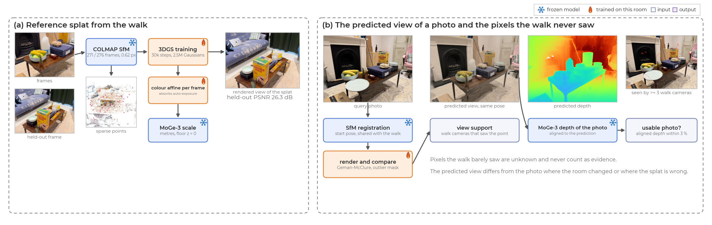
</p>

Each photo's SfM pose is then refined by rendering the splat and comparing it with the photo under a Geman-McClure loss, with the pixels that do not fit masked out at every step because some of those pixels are exactly the changes I am looking for. 65 of the 71 photos keep the refined pose, and the rendering at that pose is the predicted view, which is what the reference says the photo should show.

<p align="center">
  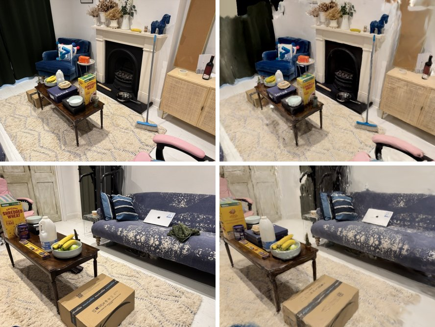
  <br><sub>Photos (left) and the splat rendered at their refined poses (right). The green cloth on the sofa is a real change.</sub>
</p>

A render also looks convincing in places the walk hardly filmed, and those are the places where it is wrong. My first idea for finding them was the splat's accumulated opacity, which failed, because the sofa close-ups rendered as solid floaters with full opacity even though I never filmed that side of the room properly. What works is to count, for every pixel, how many walk cameras saw that 3D point on their own visible surface, and to call a pixel unknown when fewer than three did, so it counts neither for nor against a change.

<p align="center">
  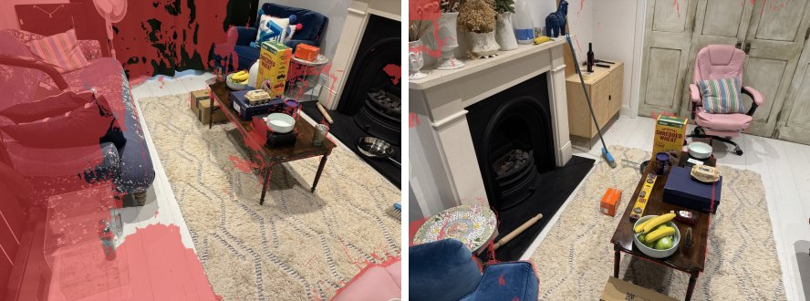
  <br><sub>Unknown pixels tinted red. Left: the sofa side, which the walk never filmed closely (59 % known). Right: a view near the walk (98 % known).</sub>
</p>

## 4. Finding and naming the objects

To say that the egg carton moved, the reference has to contain an egg carton, so I build a list of named 3D objects from the walk and my list of names, without hand-drawn masks. SAM 3 looks for each name on the full frame and on 2 x 2 tiles of the 1920 px frame so that small things have enough pixels, and every frame's masks are rendered back through the splat as a loss, which makes the gradient tell me which Gaussians belong to each detection. Detections that share Gaussians in several frames become one object. Thin things like the broom handle then grow back from the Gaussians next to them, and before any naming happens the pieces of one physical object are merged by geometry. The name then comes from two sources multiplied together, SAM 3's vote shares and SigLIP 2 zero-shot on the four clearest views of the object, so that a plain box only gets a confident name when both agree.

<p align="center">
  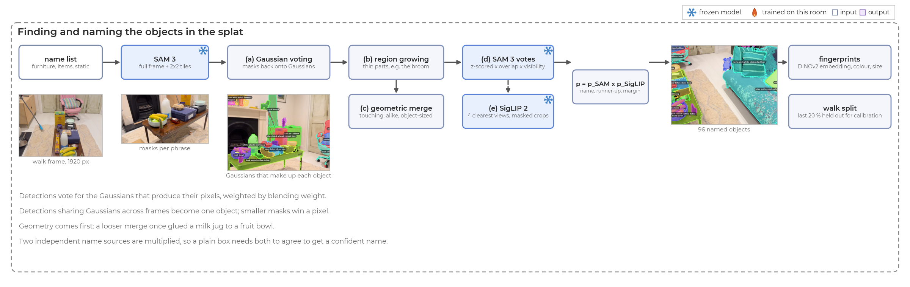
</p>

<p align="center">
  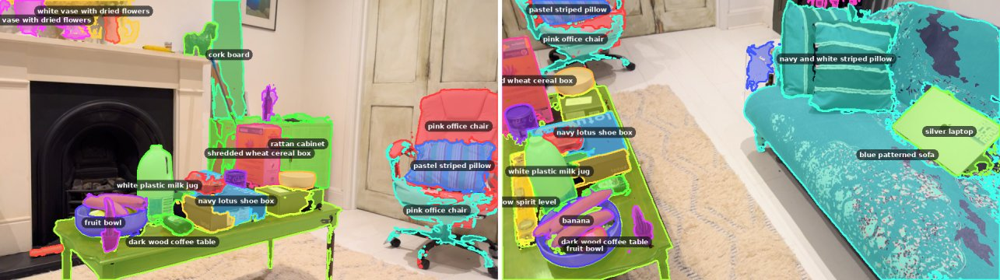
  <br><sub>Objects rendered from the splat into two walk frames. The pink office chair is split into two objects.</sub>
</p>

That gives 96 objects, and 14 of them carry a name that I mark as uncertain. I started out using per-photo SAM masks as the objects, which lost thin things such as the broom, so the objects now come from the splat. An early merge rule that only asked for similar colour or similar appearance glued a milk jug onto the fruit bowl and a shoe box, so pieces now have to touch and look alike, and the merged object has to stay object-sized. With SAM 3 alone the mantelpiece was called "wall", and adding SigLIP 2 changed 23 of the 96 names, mostly for the better.

## 5. A change checker trained on edits of the splat

Training a change detector on real changes would mean rearranging my living room hundreds of times and labelling every pixel, so I edit the splat instead. I take objects out of the splat, move or rotate them a little, or copy one to another spot, and render the edited splat from the pose of a real walk frame, which then acts as the "after" photo, and the labels follow directly: if I took the bowl out of the render, the bowl's pixels in the real frame are labelled "appeared", and the pixels of a transplanted copy are labelled "missing". A third of the pairs have no edit at all, so the model also sees what an unchanged room looks like through a render, and where an object was removed or moved I fill the empty footprint with flat inpainted Gaussians, and a few unedited renders get a decoy fill so that a filled patch on its own does not give the answer away.

<p align="center">
  
</p>

<p align="center">
  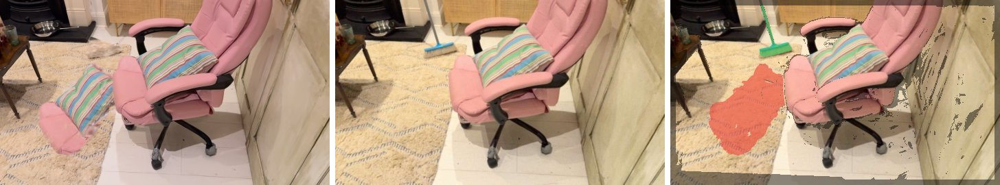
  <br><sub>A training pair: edited render, real frame, labels (green appeared, red missing, dark ignored).</sub>
</p>

The model is small on purpose, because the information is in the pair and frozen DINOv2 features carry most of the load. It takes the DINOv2 features of the render and of the photo, reduced to 128 dimensions with a PCA, together with the difference between the render's depth and the photo's MoGe-3 depth after aligning the two, and a light convolutional decoder turns that into three classes at quarter resolution. It trains in 3 minutes on 864 pairs from the first 80 % of the walk and is validated on 220 pairs from the last 20 %.

The first thing I tried was a set of hand-written rules on the same ingredients, depth residuals and appearance cosines with thresholds picked on the untouched photos, and they either raised changes on objects that had not moved or said they could not verify almost everything. On the 48 held-out pairs I could score both on, the rules found 29 % of the edits and wrongly detected 16 changes on pairs that had no edit, while the learned checker found 49 % and wrongly detected none, so the rules went.

## 6. Deciding what changed in each set of photos

Each set of three photos is compared with the reference on its own. For every usable photo, each object gets a state from the checker's maps on its rendered mask, and that state is either present or missing, or it is covered, which means something new is in front of the object and I cannot verify it. SAM 3 then runs on the photo and on a render of the reference from the same pose, so that every detection can be recognised as sitting on an object's place or as something the reference already contained, and that last check is what stops a second identical plate next to the first one from being taken for the first one. The detections that are left over from the three photos are clustered in 3D, the objects that read as missing are looked for in every cluster by a one-to-one assignment (Hungarian) on a calibrated probability that two things are the same, and the answer is read off directly: an object found elsewhere has moved, an object found nowhere with a clear view of its old place has been removed, and when the old place was not clearly seen I report nothing. Clusters that no object claims are added things, which get their names from SAM 3 votes and SigLIP 2 the same way as in section 4.

<p align="center">
  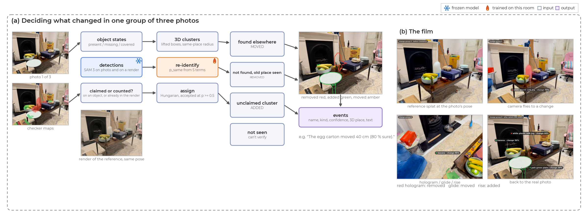
</p>

The distance within which an object counts as still being at its place is 0.63 times its size, which is the 95th percentile of where an unmoved object's detection lands in the held-out walk frames, and the other thresholds are either a calibrated probability of 0.5 or measured on those frames too. The sentence for each event comes from a template over the 3D facts, for example "The egg carton moved 40 cm (80 % sure)", because a vision-language model I tried for this wrote sentences about the viewpoint changing when the room had not.

At first I carried beliefs from one set of photos into the next ("removed earlier, so still gone"), since that is how a deployed system would work, but it spread every mistake into the sets after it and it was also the wrong model of my data because I reset the room each time, so every set is now judged against the reference alone, and that took the reported changes from 99 down to 59. An earlier version only looked for moved objects inside regions that looked new, and many moves came out as removals until I made it search for every missing object in all the photos.

<p align="center">
  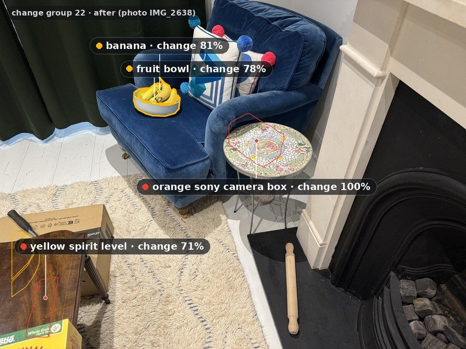
  <br><sub>Group 22. The banana and the fruit bowl were found again about a metre away, next to the armchair.</sub>
</p>

## 7. Showing the changes in a film

I wanted something I can check by eye instead of a table of numbers, so for each set the film starts on the reference splat rendered from the best photo's pose and flies to each change in turn. A removed object turns into a red hologram where it used to be. A moved object glides along an arc to its new place, and an added object rises out of the floor as points lifted from the photo's depth, so that the film ends on the real photo with the labels and the splat's memory sits next to the evidence. My first version put a label on every object at the same time and nobody could read it, so now one change is animated at a time and the stills place each label where it covers the fewest objects and the other labels.

<p align="center">
  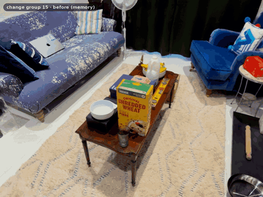
  <br><sub>Group 15: the pale green bowl, the yellow spirit level and the honey squeeze bottle were removed.</sub>
</p>

<details>
<summary>Another group</summary>
<br>
<p align="center">
  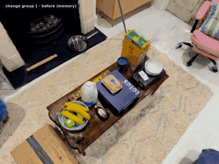
</p>
</details>

## Results

### Experimental protocol

Everything is on one room that I scanned once. The reference walk gives 276 frames, and I split it by time: the 864 training pairs of the checker and the fingerprints of the objects come from the first 80 %, and the last 20 % is held out from every calibration and supplies the 220 validation pairs of the checker. The splat itself was trained on the walk frames including that last part (apart from 25 frames kept out to measure it), so the validation renders are a little easier than renders from new poses would be. The 66 photos of the 22 change sets and the 5 photos of the untouched room are never used for training or for fitting anything in the final pipeline, and I list in the next section what I did look at while developing.

| Data | Used for | Split |
|:--|:--|:--|
| Reference walk, first 80 % by time | 864 checker training pairs, object fingerprints | train |
| Reference walk, all frames except 25 | splat training | train |
| Reference walk, last 20 % by time | 220 validation pairs, calibration of the change probabilities, same-place radius, re-identification model | held out |
| 5 photos of the untouched room | objects wrongly reported as changed | evaluation only |
| 22 change sets, 3 photos each (66 photos) | counts of reported events, and my manual scoring of sets 1 to 13 | evaluation only |

### Main comparison on the real change sets

I scored the reported events by hand against what I remember changing, which means there is no independent ground truth here. I scored the first 13 of the 22 change sets completely, which is 106 events, and I also scored 2 of the 7 events of set 14, which I left out so that all three methods are compared on the same sets, and I did not get to sets 15 to 22. For each set the top events of the three methods (at most four per method, by the method's own score) were mixed into one anonymous list, and events of the same type whose 3D boxes overlap were merged automatically before I saw them, with the same rule for every method. I gave every event one verdict: correct, right object but wrong type of change, right object but wrong name, duplicate of another event in the list, nothing like that changed, or unsure.

I did not write down how many real changes each set had, so the recall here is pooled, as it is in information retrieval: it is the number of distinct real changes a method found divided by the number found by any of the three methods, which makes it a recall relative to the three methods together and not against everything I changed. A duplicate of another method's correct event counts as a correct detection for its own method, since it reports the same real change, but it is left out of the type and name accuracy because only the first card was judged for those. Duplicates within one method are counted as redundancy and left out of precision, and an unsure verdict counts as not correct. The intervals are Wilson 95 % intervals, and since the events are clustered in sets they are narrower than they should be.

SceneDiff is the published method run from its public code, with three changes I had to make: the DINOv2 ViT-L features stand in for DINOv3, whose weights need a gated download, it uses Pi3 for geometry, and its reference side is 32 of the 64 reference keyframes because the full set did not fit in GPU memory next to the other jobs. It is also built to compare two videos, and here its second side is three photos, so this is a comparison with a reasonable setup of that method and not a tuned one. The rule-based method uses the same inventory as the full pipeline and pairs objects by name instead of using the learned checker. The three methods were shown to me mixed together with the method names hidden, although SceneDiff cards for removed objects show a crop of the reference frame, which may have given them away.

| Method | Events scored | Precision (95 % CI) | Recall, pooled (95 % CI) | Type accuracy (95 % CI) | Name accuracy (95 % CI) | Redundancy (95 % CI) |
|:--|:-:|:-:|:-:|:-:|:-:|:-:|
| Full pipeline | 32 | 94 % (80-98) | 47 % (35-59) (29 of 62) | 80 % (61-91) | 100 % (87-100) | 0 % (0-11) |
| SceneDiff (DINOv2 variant) | 45 | 65 % (50-78) | 45 % (33-57) (28 of 62) | 65 % (45-81) | 91 % (73-98) | 4 % (1-15) |
| Rules (phrase pairing on the inventory) | 29 | 85 % (68-94) | 34 % (23-46) (21 of 62) | 50 % (27-73) | 100 % (78-100) | 7 % (2-22) |

| Method | Correct | Wrong type | Wrong name | Duplicate of another method's correct event | Duplicate within the method | Nothing like that changed | Unsure |
|:--|:-:|:-:|:-:|:-:|:-:|:-:|:-:|
| Full pipeline | 20 | 5 | 0 | 5 | 0 | 2 | 0 |
| SceneDiff (DINOv2 variant) | 13 | 8 | 2 | 5 | 2 | 10 | 5 |
| Rules (phrase pairing on the inventory) | 7 | 7 | 0 | 9 | 2 | 4 | 0 |

<p align="center">
  
</p>

The full pipeline and SceneDiff find about the same number of the 62 distinct real changes (29 and 28), while the pipeline reports far fewer events that were wrong, so its precision is higher (94 % against 65 %) and the two intervals do not overlap. Both find somewhat more than the rules (21), although those intervals overlap. The change-type accuracy is where the wrong answers pile up for all three methods: the 20 cards with the right object and the wrong type are all objects that I had moved, and 18 of them were reported as removed or added, so what goes wrong most often is deciding that an object in the photo is the same one as in the reference, and only 2 cards in the whole list had the right object with a wrong name, both from SceneDiff. The per-set counts are in `examples/manual_review/per_group.csv`.

### Ablations

Each row changes one thing and names the data it was measured on.

| Variant | Measured on | Metric | Result | Compared with |
|:--|:--|:--|:--|:--|
| Learned checker against hand-written rules | 48 held-out validation pairs | object recall, wrongly detected changes on pairs without an edit | 0.49 and 0 | rules: 0.29 and 16 |
| Each set against the reference, against carrying state between sets | the 22 change sets | events reported | 59 | carrying state: 99 |
| Objects from the splat, against SAM automatic masks as objects | the 22 change sets | events reported | 99 (carried state) | SAM masks: 132 |

On the untouched room every one of these variants reports nothing wrongly, so that column does not separate them, and the event counts only say how much each variant reports, not how much of it is right, which is what the manual scoring above is for.

### Recall on held-out synthetic edits by type and size

This is the only place where I have labels for every pixel, because the edits are made by me in the splat. An edit counts as found when a quarter of its region gets the right class from the checker, and the numbers are on the 220 validation pairs.

<p align="center">
  
</p>

| Edit | Edits (n) | Recall | Edit size | Edits (n) | Recall |
|:--|:-:|:-:|:--|:-:|:-:|
| Remove | 52 | 0.98 | under 15 cm | 23 | 0.87 |
| Add | 47 | 0.98 | 15 to 40 cm | 100 | 0.93 |
| Move 15 to 60 cm | 28 | 0.96 | over 40 cm | 68 | 0.94 |
| Move 2 to 10 cm | 35 | 0.86 | | | |
| Move 2 to 5 cm | 12 | 0.75 | | | |
| Rotate | 29 | 0.79 | | | |

Over all 191 edits the recall is 0.93, the pixel F1 is 0.86 for appeared and 0.90 for missing, and 0.1 % of the pixels of the 78 pairs without an edit are flagged. The jump from 0.93 here to 0.49 on the 48-pair comparison is the object step that sat on top of SAM masks in the earlier version, which is why the final pipeline reads the checker's maps on the objects' own rendered masks.

### Calibration

The change probabilities are Platt-scaled on those held-out edits with two folds split by frame, and probabilities from several photos that agree are combined by noisy-OR.

<p align="center">
  
</p>

| Model | ECE (out of fold) | AUC | Positives | Negatives |
|:--|:-:|:-:|:-:|:-:|
| P(missing) | 0.014 | | 134 | 3347 |
| P(appeared) | 0.016 | | 140 | 3347 |
| P(moved) | 0.026 | | 58 | 584 |
| Same object (re-identification) | 0.027 | 0.92 | 997 | 4739 |
| Something added | 0.047 | 0.95 | 100 | 288 |

Most of the low ECE comes from the thousands of negatives near zero. The middle bins hold few samples and the curves lie above the diagonal there, so the model is cautious in that range, and the noisy-OR over photos is an extrapolation because every synthetic pair has a single view.

### Objects wrongly reported as changed in the 5 photos of the untouched room

Every method was run on the same 5 photos of the untouched room, where nothing should be reported.

<p align="center">
  
</p>

| Method | Objects wrongly reported as changed (5 untouched photos) | Events reported (22 change sets) | Remark |
|:--|:-:|:-:|:--|
| Rules on Pi3X features, per photo | 0 | 2.7 per photo | 72 % of all answers were "can't verify" |
| SceneDiff (DINOv2 variant) | 16 | 245 | 49 s per pair without SAM, 9 GB |
| Depth and appearance blobs fused in 3D | 0 | 238 blobs | no object identity |
| SAM masks matched between render and photo | 0 | 109 | |
| Learned checker with SAM masks as objects | 0 | 132 | |
| VLM judge (Qwen3-VL-4B) | 21 reports, 3 distinct | 179 | |
| Learned checker with the inventory, state carried between sets | 0 | 99 | |
| Full pipeline, each set against the reference | 0 | 59 | 26 added, 18 removed, 15 moved |

A method that reports nothing gets a zero here too, so this column only says something together with the counts next to it, and the 5 photos are a small sample: zero wrong reports on 5 photos is compatible with a rate well above zero.

## What was fixed by hand and what was tuned on what

The only input that is specific to this room is the list of object names. I wrote it myself after looking at the photos, so it knows about things like the "fox print bowl" and the "navy lotus shoe box" that nobody would guess from the video alone. An earlier version also had a review file of hand-made renames and merges of the inventory, and I removed it and everything that used it, so the numbers here come from the automatic names only.

Every threshold of the final pipeline is either a calibrated probability of 0.5, or a value measured on the held-out last 20 % of the walk and on the synthetic edits of it, and none of them was fitted on the change sets. That is not the whole story of how the pipeline came to look the way it does, because I looked at the real change sets while developing it and a few decisions were made with them in front of me. The rule that an object only counts as newly missing when at least two photos or one clear view show it missing and more photos show it missing than present, and the matching of a detection to an object's place, were adopted after I looked at change sets 1 and 5, so those two sets are not a clean test of them. Earlier versions of the pipeline chose their heatmap thresholds on group 0, the 5 untouched photos, and the depth-blob and SAM-matching baselines chose their gates there too, so for those baselines the untouched room is a tuning set and their zero wrongly reported objects there says little. The threshold for pairing a removal with an addition into one move was also set with the real sets in view. The 3 % limit on how far the aligned photo depth may disagree with the prediction before I drop a photo and the choice of 3 cameras for a pixel to count as known come from the time I was developing on the real photos as well, and my notes do not say which sets I was looking at.

The confidences are calibrated on synthetic edits of the walk and real photos come from different places, so they may be overconfident on real photos, and I have not checked that.

## Limitations and what's next

The weakest part is naming and identity for plain boxes. In group 5 the Shredded Wheat box is reported as "kelloggs cereal box added", and the runner-up name of most box events is another box. An object also sometimes turns into two events, such as a box reported as removed and then as moved 38 cm in the same set.

<p align="center">
  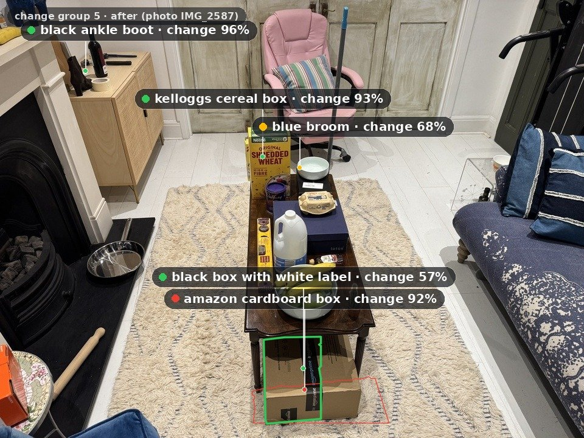
  <br><sub>Group 5. The Shredded Wheat box on the table is labelled "kelloggs cereal box", and the black box at the bottom was there before.</sub>
</p>

While scoring I got an impression of where the mistakes come from, and I want to be clear about which parts of it the table supports. What it supports is that the changes that go wrong are mostly identity problems: the right object was found but I had moved it and the method called it removed or added, 20 cards across the three methods, against 2 cards with a wrong name, so deciding which object in one scene is the same one in the other scene is harder than seeing that something changed or what to call it. Many of the changes were deliberately difficult, since a moved object often disturbed its neighbours or sat next to an identical one, and that fits this. The rest is my impression from looking at the wrong cards and I did not measure it: the splat was not good enough in places, which hurt mostly on small and far objects and which also makes the SAM 3 masks weaker on those parts of the render, and occlusion by other objects did not seem to be a main source of confusion. Together these make me think the next step is better identity matching and a better splat, and not more checker training.

The walk covered the coffee table well and the edges of the room badly, so 10 of the 71 photos fail the depth-alignment check, including all three photos of group 19, and changes behind the sofa cannot be verified. The metric scale comes from monocular depth, and MoGe-3 and Pi3X disagree by about 11 % on this room, which the distances in the film inherit. I scored only 13 of the 22 sets, I am the person who made the changes and the person scoring them, and the whole thing is one room filmed once with one phone, so it shows that the approach can work and says little about how well it carries over to another place.

Next I want a sharper object step for thin objects and plain boxes, since the checker sees most of those changes in its pixel maps and it is the name and identity step where they get lost. I also want ground-truth scoring on more rooms than this one, which means filming more scenes and making changes in them the same way, so that the results do not rest on a single living room. I will keep posting progress on the [project page](https://ar3o.github.io/where-did-my-stuff-go/), and the full tables and settings are in [docs/results.md](docs/results.md) and [docs/method.md](docs/method.md).

## Running it

Setup is in [docs/installation.md](docs/installation.md) and every stage is explained in [docs/running.md](docs/running.md).

```bash
export PYTHONPATH=$PWD
# everything at once: reference video + photos + name list -> results/
$SPLAT_PY -m whatchanged.run --reference ref.MOV --queries photos/*.HEIC --names examples/config1_names.json \
    --groups examples/config1_groups.json --out results/

# or stage by stage
S=config1
$SPLAT_PY -m whatchanged.ingest.run --scene $S --reference ref.MOV --queries photos/*.HEIC --groups groups.json --names names.json
$SPLAT_PY -m whatchanged.sfm.run --scene $S          # MoGe-3 depth, COLMAP, metric world frame
$SPLAT_PY -m whatchanged.splat.run --scene $S        # train, localise photos, support maps
$SPLAT_PY -m whatchanged.inventory.run --scene $S    # SAM 3 on tiles, Gaussian voting, names
$SPLAT_PY -m whatchanged.checker.run --scene $S      # edited-splat pairs, training, calibration
$SPLAT_PY -m whatchanged.changes.run --scene $S      # per-group decisions
$SPLAT_PY -m whatchanged.render.film --scene $S      # film and stills
```

That runs all seven stages and copies `changes_gXX.json`, `summary.json`, `confidences.md`, the stills and the film to `results/`. Every stage skips work that is already done. The three Python environments (splat, vision models, SAM 3) are described in [docs/installation.md](docs/installation.md), and every step and output file in [docs/running.md](docs/running.md).

Inputs are a walk-around video, photos or a video taken later, and a name list ([examples/config1_names.json](examples/config1_names.json)); groups of photos are optional ([examples/config1_groups.json](examples/config1_groups.json)). [examples/config1_output/](examples/config1_output) has the summary of all groups and the full output of group 8:

```
group 8: white plastic milk jug removed (99%); banana added (96%); pale green plate added (56%)
```

```
whatchanged/
  ingest/      video decoding with HDR tone mapping, sharp frames, HEIC photos
  sfm/         pycolmap SfM with the photos, metric world frame
  splat/       gsplat training, cleanup, render-and-compare localisation, support maps
  inventory/   SAM 3 on tiles, Gaussian voting, region growing, geometric merge, SigLIP 2 names
  checker/     edited-splat training pairs, model, training, inference, calibration
  changes/     re-identification, instance counting, per-group decisions, text
  render/      the film and stills
  evaluation/  scoring of reported changes against my hand verdicts
  common/      geometry, depth alignment, GPU guard, model workers
configs/       one YAML per stage, defaults = the settings behind the results
scripts/       shell drivers for the longer stages
docker/        container definitions for the splat and vision environments
examples/      name list, photo groups, an example output and the hand scores
```

<details markdown="1">
<summary>Ideas borrowed from other work</summary>

| Idea | Where it's from | Used for |
|:--|:--|:--|
| 3D Gaussian splatting | Kerbl et al., 2023; [gsplat](https://github.com/nerfstudio-project/gsplat) (Ye et al., 2024) | the reference model, every render |
| Structure from motion | [COLMAP](https://github.com/colmap/colmap) (Schönberger and Frahm, 2016) | camera poses of frames and photos |
| Antialiased splat rendering | Mip-Splatting (Yu et al., 2024) | rendering at the photos' resolution |
| Render-and-compare pose refinement | iNeRF (Yen-Chen et al., 2021) | refining photo poses |
| Geman-McClure loss | Geman and McClure, 1987 | pose refinement |
| Text-prompted segmentation | [SAM 3](https://github.com/facebookresearch/sam3) (Meta, 2025) | inventory and photo detections |
| Self-supervised features | [DINOv2](https://github.com/facebookresearch/dinov2) (Oquab et al., 2024) | checker input, fingerprints |
| Zero-shot image-text naming | SigLIP 2 (Tschannen et al., 2025) | object names, re-identification |
| Metric monocular depth | [MoGe](https://github.com/microsoft/MoGe) (Wang et al., 2025) | scale, depth in the checker |
| Lifting 2D masks onto Gaussians | Gaussian Grouping (Ye et al., 2024), SAGA (Cen et al., 2025) | inventory voting |
| Scene change detection from two captures | SceneDiff (2025); 3DGS-CD (Lu et al., 2025) | the problem setup and a baseline |
| Training on synthetic changes | CYWS-3D (Sachdeva and Zisserman, 2023) | edits of the splat as training data |
| MCMC densification | Kheradmand et al., 2024 | tried for a later splat; these results use gsplat's default strategy |
| Platt scaling, ECE | Platt, 1999; Guo et al., 2017 | calibrated change confidences |
| Hungarian assignment | Kuhn, 1955 | one-to-one re-identification |
| Focal loss | Lin et al., 2017 | checker training |

</details>

<details markdown="1">
<summary>What I tried before this pipeline</summary>

The pipeline above is the fifth design, and the earlier ones are gone from this repository but their numbers are in the results table. The first was a set of rules on per-object features from a Pi3X reconstruction (visibility, depth residuals, appearance), the second was the official SceneDiff, a training-free video-to-video method, the third fused per-pixel depth and appearance differences into 3D blobs, and the fourth matched SAM automatic masks between the render and the photo. The fifth is the learned checker, which first sat on top of SAM masks and then on the inventory of named objects, with every set judged against the reference on its own. A VLM judge (Qwen3-VL) given the nearest reference keyframe and the photo was tried alongside and listed 21 changes for the untouched room, three distinct ones repeated.

</details>

## Built with

| Component | Used for |
|:--|:--|
| [gsplat](https://github.com/nerfstudio-project/gsplat) 1.5.3 | splat training and rendering |
| [pycolmap](https://github.com/colmap/pycolmap) | SfM |
| SAM 3 (Meta) | detections from text prompts |
| DINOv2 ViT-L/14 with registers (Meta) | features |
| SigLIP 2 so400m (Google) | names, re-identification |
| MoGe-3 (Microsoft) | metric depth |
| PyTorch, OpenCV, SciPy, ffmpeg | everything else |

## License

The code in this repository is MIT licensed. Third-party models keep their own licences.
