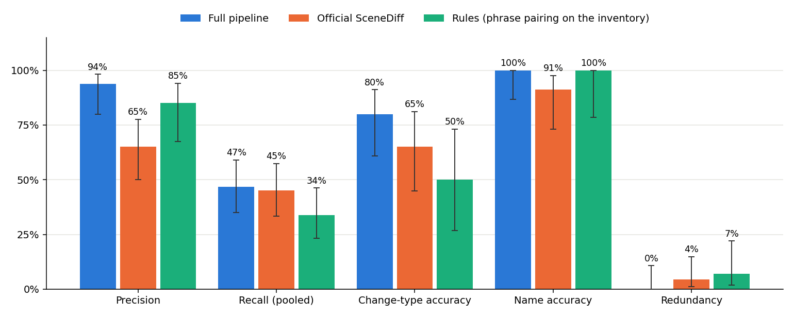
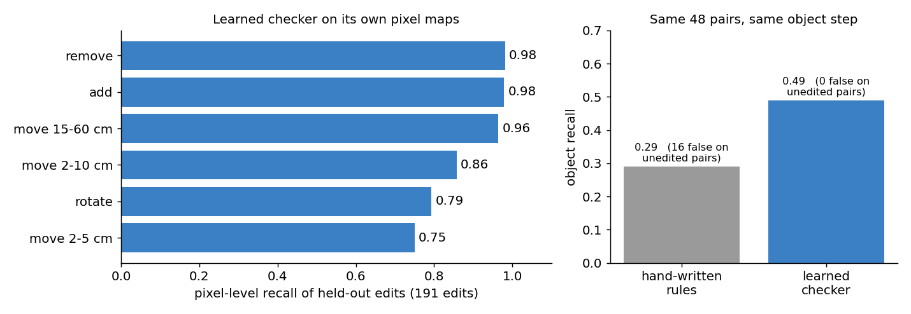
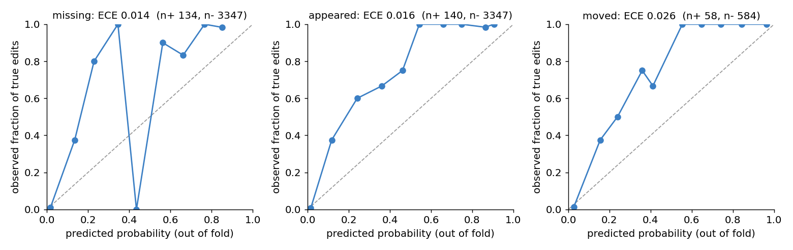
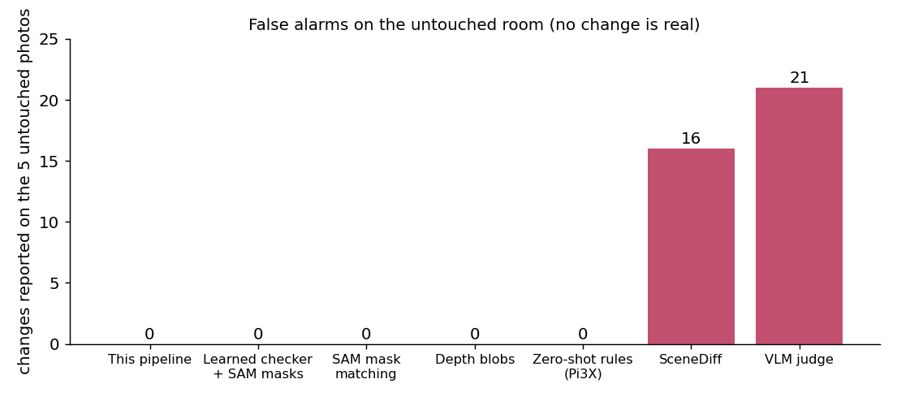

# Appendix: full results and checks

The README keeps the main result of the photo change sets, my own labelling of what each method reported against SceneDiff and a rule-based baseline, plus a few lines on the other checks. The full protocol, the other scoring columns, the ablations, the synthetic-edit recall, the calibration and the untouched-room test are here.

There is no ground truth for real room changes that I could download, so every number here rests on my own labels, made from the real frames and photos of a room I changed myself.

## The photo change sets

### Experimental protocol

Everything is on one room that I scanned once. The reference walk gives 276 frames, and I split it by time: the 864 training pairs of the checker and the fingerprints of the objects come from the first 80 %, and the last 20 % is held out from every calibration and supplies the 220 validation pairs of the checker. The splat itself was trained on the walk frames including that last part (apart from 25 frames kept out to measure it), so the validation renders are a little easier than renders from new poses would be. The 66 photos of the 22 change sets and the 5 photos of the untouched room are never used for training or for fitting anything in the final pipeline, and I list in the next section what I did look at while developing.

| Data | Used for | Split |
|:--|:--|:--|
| Reference walk, first 80 % by time | 864 checker training pairs, object fingerprints | train |
| Reference walk, all frames except 25 | splat training | train |
| Reference walk, last 20 % by time | 220 validation pairs, calibration of the change probabilities, same-place radius, re-identification model | held out |
| 5 photos of the untouched room | objects wrongly reported as changed | evaluation only |
| 22 change sets, 3 photos each (66 photos) | counts of reported events, and my manual scoring of sets 1 to 13 | evaluation only |

### Main comparison on the real change sets

I scored the reported events by hand against what I remember changing, which means there is no independent ground truth here. I scored the first 13 of the 22 change sets completely, which is 106 events, and I also scored 2 of the 7 events of set 14, which I left out so that all three methods are compared on the same sets, and I did not get to sets 15 to 22. For each set the top events of the three methods (at most four per method, by the method's own score) were mixed into one anonymous list, and events of the same type whose 3D boxes overlap were merged automatically before I saw them, with the same rule for every method. I gave every event one verdict: correct, right object but wrong type of change, right object but wrong name, duplicate of another event in the list, nothing like that changed, or unsure.

I did not write down how many real changes each set had, so the recall here is pooled, as it is in information retrieval: it is the number of distinct real changes a method found divided by the number found by any of the three methods, which makes it a recall relative to the three methods together and not against everything I changed. A duplicate of another method's correct event counts as a correct detection for its own method, since it reports the same real change, but it is left out of the type and name accuracy because only the first card was judged for those. Duplicates within one method are counted as redundancy and left out of precision, and an unsure verdict counts as not correct. The intervals are Wilson 95 % intervals, and since the events are clustered in sets they are narrower than they should be.

SceneDiff is the published method run from its public code, with three changes I had to make: the DINOv2 ViT-L features stand in for DINOv3, whose weights need a gated download, it uses Pi3 for geometry, and its reference side is 32 of the 64 reference keyframes because the full set did not fit in GPU memory next to the other jobs. It is also built to compare two videos, and here its second side is three photos, so this is a comparison with a reasonable setup of that method and not a tuned one. The rule-based method uses the same inventory as the full pipeline and pairs objects by name instead of using the learned checker. The three methods were shown to me mixed together with the method names hidden, although SceneDiff cards for removed objects show a crop of the reference frame, which may have given them away.

| Method | Events scored | Precision (95 % CI) | Recall, pooled (95 % CI) | Type accuracy (95 % CI) | Name accuracy (95 % CI) | Redundancy (95 % CI) |
|:--|:-:|:-:|:-:|:-:|:-:|:-:|
| Full pipeline | 32 | 94 % (80-98) | 47 % (35-59) (29 of 62) | 80 % (61-91) | 100 % (87-100) | 0 % (0-11) |
| SceneDiff (DINOv2 variant) | 45 | 65 % (50-78) | 45 % (33-57) (28 of 62) | 65 % (45-81) | 91 % (73-98) | 4 % (1-15) |
| Rules (phrase pairing on the inventory) | 29 | 85 % (68-94) | 34 % (23-46) (21 of 62) | 50 % (27-73) | 100 % (78-100) | 7 % (2-22) |

| Method | Correct | Wrong type | Wrong name | Duplicate of another method's correct event | Duplicate within the method | Nothing like that changed | Unsure |
|:--|:-:|:-:|:-:|:-:|:-:|:-:|:-:|
| Full pipeline | 20 | 5 | 0 | 5 | 0 | 2 | 0 |
| SceneDiff (DINOv2 variant) | 13 | 8 | 2 | 5 | 2 | 10 | 5 |
| Rules (phrase pairing on the inventory) | 7 | 7 | 0 | 9 | 2 | 4 | 0 |

  

The full pipeline and SceneDiff find about the same number of the 62 distinct real changes (29 and 28), while the pipeline reports far fewer events that were wrong, so its precision is higher (94 % against 65 %) and the two intervals do not overlap. Both find somewhat more than the rules (21), although those intervals overlap. The change-type accuracy is where the wrong answers pile up for all three methods: the 20 cards with the right object and the wrong type are all objects that I had moved, and 18 of them were reported as removed or added, so what goes wrong most often is deciding that an object in the photo is the same one as in the reference, and only 2 cards in the whole list had the right object with a wrong name, both from SceneDiff. The per-set counts are in `examples/manual_review/per_group.csv`.

<b>Checks on parts of the pipeline</b> (ablations, synthetic edits, calibration, the untouched room)

### Ablations

Each row changes one thing and names the data it was measured on.

| Variant | Measured on | Metric | Result | Compared with |
|:--|:--|:--|:--|:--|
| Learned checker against hand-written rules | 48 held-out validation pairs | object recall, wrongly detected changes on pairs without an edit | 0.49 and 0 | rules: 0.29 and 16 |
| Each set against the reference, against carrying state between sets | the 22 change sets | events reported | 59 | carrying state: 99 |
| Objects from the splat, against SAM automatic masks as objects | the 22 change sets | events reported | 99 (carried state) | SAM masks: 132 |

On the untouched room every one of these variants reports nothing wrongly, so that column does not separate them, and the event counts only say how much each variant reports, not how much of it is right, which is what the manual scoring above is for.

### Recall on held-out synthetic edits by type and size

This is the only place where I have labels for every pixel, because the edits are made by me in the splat. An edit counts as found when a quarter of its region gets the right class from the checker, and the numbers are on the 220 validation pairs.

  

| Edit | Edits (n) | Recall | Edit size | Edits (n) | Recall |
|:--|:-:|:-:|:--|:-:|:-:|
| Remove | 52 | 0.98 | under 15 cm | 23 | 0.87 |
| Add | 47 | 0.98 | 15 to 40 cm | 100 | 0.93 |
| Move 15 to 60 cm | 28 | 0.96 | over 40 cm | 68 | 0.94 |
| Move 2 to 10 cm | 35 | 0.86 | | | |
| Move 2 to 5 cm | 12 | 0.75 | | | |
| Rotate | 29 | 0.79 | | | |

Over all 191 edits the recall is 0.93, the pixel F1 is 0.86 for appeared and 0.90 for missing, and 0.1 % of the pixels of the 78 pairs without an edit are flagged. The jump from 0.93 here to 0.49 on the 48-pair comparison is the object step that sat on top of SAM masks in the earlier version, which is why the final pipeline reads the checker's maps on the objects' own rendered masks.

### Calibration

The change probabilities are Platt-scaled on those held-out edits with two folds split by frame, and probabilities from several photos that agree are combined by noisy-OR.

  

| Model | ECE (out of fold) | AUC | Positives | Negatives |
|:--|:-:|:-:|:-:|:-:|
| P(missing) | 0.014 | | 134 | 3347 |
| P(appeared) | 0.016 | | 140 | 3347 |
| P(moved) | 0.026 | | 58 | 584 |
| Same object (re-identification) | 0.027 | 0.92 | 997 | 4739 |
| Something added | 0.047 | 0.95 | 100 | 288 |

Most of the low ECE comes from the thousands of negatives near zero. The middle bins hold few samples and the curves lie above the diagonal there, so the model is cautious in that range, and the noisy-OR over photos is an extrapolation because every synthetic pair has a single view.

### Objects wrongly reported as changed in the 5 photos of the untouched room

Every method was run on the same 5 photos of the untouched room, where nothing should be reported.

  

| Method | Objects wrongly reported as changed (5 untouched photos) | Events reported (22 change sets) | Remark |
|:--|:-:|:-:|:--|
| Rules on Pi3X features, per photo | 0 | 2.7 per photo | 72 % of all answers were "can't verify" |
| SceneDiff (DINOv2 variant) | 16 | 245 | 49 s per pair without SAM, 9 GB |
| Depth and appearance blobs fused in 3D | 0 | 238 blobs | no object identity |
| SAM masks matched between render and photo | 0 | 109 | |
| Learned checker with SAM masks as objects | 0 | 132 | |
| VLM judge (Qwen3-VL-4B) | 21 reports, 3 distinct | 179 | |
| Learned checker with the inventory, state carried between sets | 0 | 99 | |
| Full pipeline, each set against the reference | 0 | 59 | 26 added, 18 removed, 15 moved |

A method that reports nothing gets a zero here too, so this column only says something together with the counts next to it, and the 5 photos are a small sample: zero wrong reports on 5 photos is compatible with a rate well above zero.

## What was fixed by hand and what was tuned on what

The only input that is specific to this room is the list of object names. I wrote it myself after looking at the photos, so it knows about things like the "fox print bowl" and the "navy lotus shoe box" that nobody would guess from the video alone. An earlier version also had a review file of hand-made renames and merges of the inventory, and I removed it and everything that used it, so the numbers here come from the automatic names only.

Every threshold of the final pipeline is either a calibrated probability of 0.5, or a value measured on the held-out last 20 % of the walk and on the synthetic edits of it, and none of them was fitted on the change sets. That is not the whole story of how the pipeline came to look the way it does, because I looked at the real change sets while developing it and a few decisions were made with them in front of me. The rule that an object only counts as newly missing when at least two photos or one clear view show it missing and more photos show it missing than present, and the matching of a detection to an object's place, were adopted after I looked at change sets 1 and 5, so those two sets are not a clean test of them. Earlier versions of the pipeline chose their heatmap thresholds on group 0, the 5 untouched photos, and the depth-blob and SAM-matching baselines chose their gates there too, so for those baselines the untouched room is a tuning set and their zero wrongly reported objects there says little. The threshold for pairing a removal with an addition into one move was also set with the real sets in view. The 3 % limit on how far the aligned photo depth may disagree with the prediction before I drop a photo and the choice of 3 cameras for a pixel to count as known come from the time I was developing on the real photos as well, and my notes do not say which sets I was looking at.

The confidences are calibrated on synthetic edits of the walk and real photos come from different places, so they may be overconfident on real photos, and I have not checked that.
